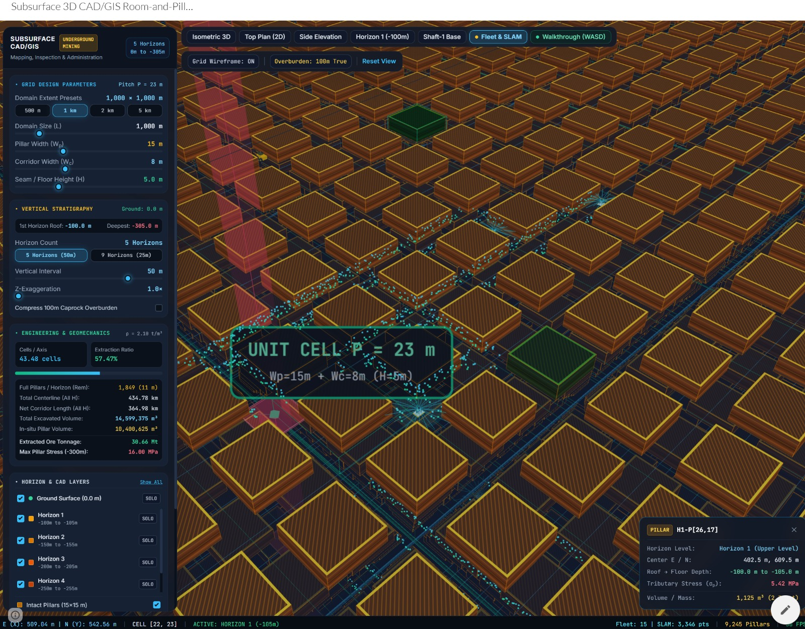

# Room-and-Pillar Mining: Underground Surveying and 3D CAD/GIS

A research and simulation project for underground survey control network design, traverse accuracy assessment, and interactive 3D visualization of room-and-pillar mining environments.

## Interactive 3D Mine Model

**[Launch the interactive 3D machinery and ramp model](https://phisan-chula.github.io/2027-RoomPillar/room_pillar_machinery_ramp.html)** (Click the “Fleet & SLAM” button to explore a simulation of autonomous wheeled robots performing routine patrols, SLAM-based mapping, and underground inspections, alongside the logistics and operations of underground mining machinery.).

The browser-based demonstration provides configurable room-and-pillar geometry, multiple mining horizons, engineering and geomechanical indicators, 3D and 2D views, virtual walkthroughs, and illustrative machinery fleet and SLAM visualization.

### Room-and-Pillar Mining with Machinery and Access Ramps

[View or download the HTML source](room_pillar_machinery_ramp.html) — alternatively, download the HTML file and open it in a WebGL-enabled browser with internet access.

### Example mine configuration

| Parameter | Value |
|---|---:|
| Model extent | 1,000 × 1,000 m |
| Pillar dimensions | 15 × 15 m |
| Corridor width | 8 m |
| Unit cell pitch | 23 m |
| Excavation height | 5 m |
| Mining horizons | 5 |
| Vertical interval | 50 m |

## Underground Traverse Network Simulation

The Python simulation investigates error propagation and geometric degeneracy in long underground survey control networks, where GNSS positioning is unavailable. It compares total station observation strategies, consecutive station links, and supplementary gyro-theodolite azimuth observations using least-squares network adjustment.

| Simulation parameter | Configuration |
|---|---|
| Traverse length | 5 km and 10 km |
| Control target spacing | 250 m (example simulation) |
| Horizontal direction standard deviation | 2 arcsec |
| Distance standard deviation | 3 mm |
| Gyro-azimuth standard deviation | 5, 20 or 60 arcsec |
| Network datum | Inner-constraint and fixed-control scenarios |
| Error ellipses | 95% confidence level |

Simulation cases compare networks with and without consecutive total station links and gyro observations, including gyro observation intervals of every fifth and tenth total station setup.

## Research Objectives

- Quantify longitudinal and transverse positioning uncertainty in extended underground traverses.
- Assess the contribution of gyro-theodolite azimuth observations and total station network connectivity.
- Compare survey control strategies for long underground corridors.
- Explore integration of underground survey control, 3D CAD/GIS, machinery navigation and SLAM-based mapping.

**Research prototype:** Simulation results and illustrative mine geometry are intended for research and engineering evaluation, not as a substitute for site-specific survey or geotechnical design validation.
